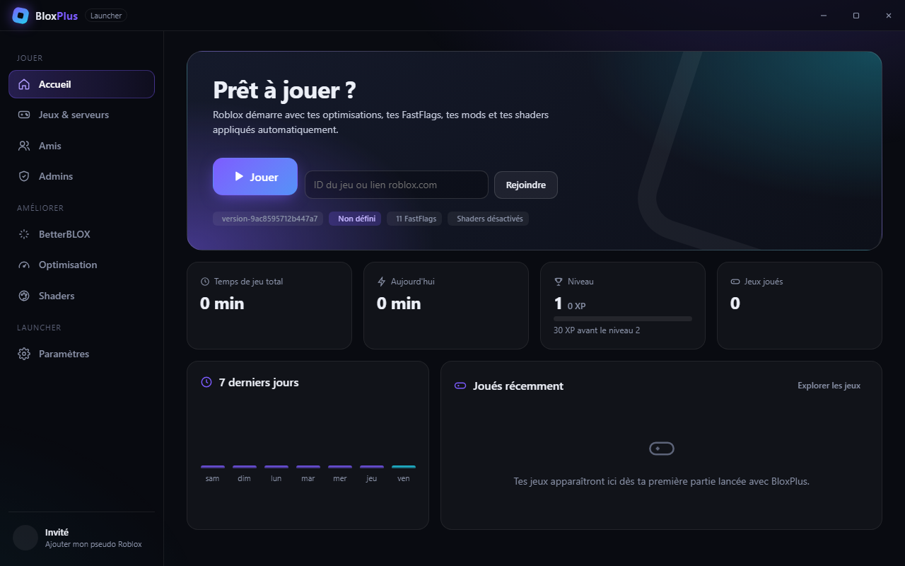
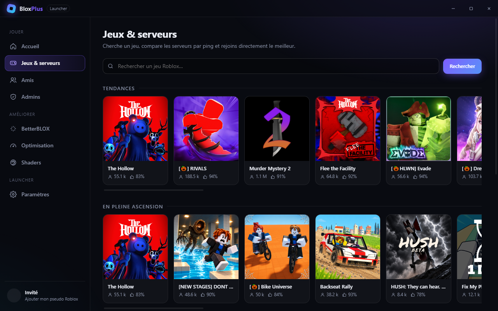
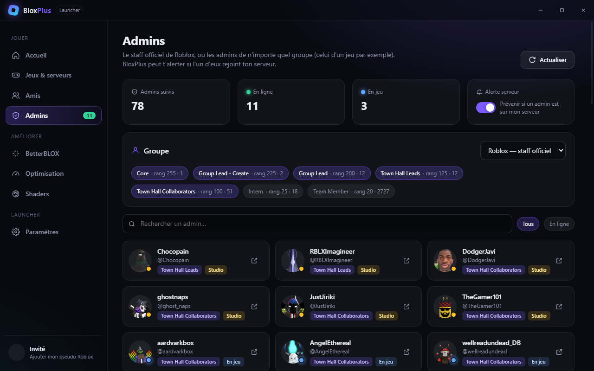
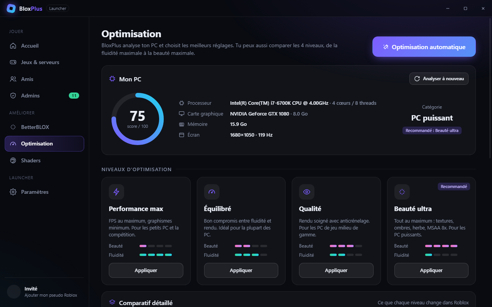
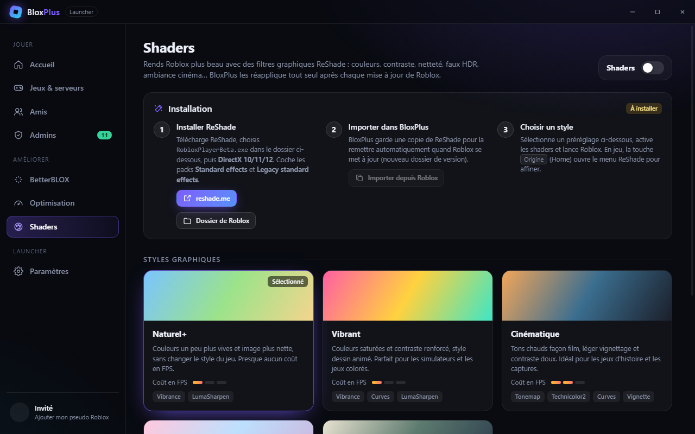

# BloxPlus Launcher

Un launcher Roblox pour Windows, plus beau que celui d'origine, avec les options de **BetterBLOX** (BetterStrap / BetterLauncher), un onglet **Admins**, une **optimisation automatique** selon ton PC et des **shaders** pour embellir le jeu.



## Fonctions

| Onglet | Ce qu'il fait |
| --- | --- |
| **Accueil** | Bouton Jouer, rejoindre un jeu par ID ou lien, temps de jeu total / du jour, niveau et XP, graphique des 7 derniers jours, jeux récents. |
| **Jeux & serveurs** | Recherche de jeux, tendances, favoris. Pour chaque jeu : liste des serveurs publics avec ping, FPS et remplissage, bouton « Meilleur serveur » (ping le plus bas) et « Petit serveur ». |
| **Amis** | Amis en ligne / en jeu, bouton Rejoindre, « vu en ligne pour la dernière fois » mémorisé par le launcher, notifications de connexion. |
| **Admins** | Le staff officiel de Roblox (groupe 1200769, rangs 100 et plus) ou les admins de n'importe quel groupe, avec leur statut. Alerte si un admin se trouve sur ton serveur. |
| **BetterBLOX** | Éditeur de FastFlags (réglages simples + édition libre, import/export JSON, indication des flags autorisés par Roblox), multi-instance, mods, région du serveur à la connexion, overlay du temps de jeu, notifications. |
| **Optimisation** | Analyse du PC (CPU, GPU, VRAM, RAM, écran) avec un score sur 100, optimisation automatique, 4 niveaux comparables (Performance max, Équilibré, Qualité, Beauté ultra), GPU haute performance, optimisations plein écran, priorité haute, nettoyage du cache. |
| **Shaders** | Installation guidée de ReShade, 5 styles fournis (Naturel+, Vibrant, Cinématique, Réaliste HDR, Rêve pastel), réapplication automatique après chaque mise à jour de Roblox. |
| **Paramètres** | Pseudo Roblox, ouverture des jeux de roblox.com avec BloxPlus, couleur du launcher. |

<p>
  
  
  
  
</p>

## Installation

Il faut [Node.js](https://nodejs.org) 20 ou plus récent.

```bash
git clone https://github.com/bibouze/bloxplus-launcher.git
cd bloxplus-launcher
npm install
npm start
```

Pour fabriquer un installateur `.exe` (dossier `dist/`) :

```bash
npm run dist
```

Les installateurs sont aussi construits automatiquement par GitHub Actions quand une version est publiée (tag `v*`).

## Comment ça marche

- **Lancement** : BloxPlus écrit tes FastFlags dans `ClientSettings/ClientAppSettings.json`, copie tes mods et ReShade dans le dossier de version de Roblox, puis démarre `RobloxPlayerBeta.exe` (avec un lien `roblox://experiences/start?...` pour rejoindre un jeu ou un serveur précis).
- **Premier démarrage** : les FastFlags déjà présents dans Roblox sont importés, rien n'est perdu.
- **Optimisation** : les niveaux modifient la qualité graphique et la limite d'images/s dans `GlobalBasicSettings_13.xml` (seulement quand Roblox est fermé, une sauvegarde `.bloxplus.bak` est faite) et les FastFlags de la liste autorisée par Roblox.
- **Multi-instance** : BloxPlus garde le verrou `ROBLOX_singletonMutex`, comme Bloxstrap.
- **Temps de jeu et région** : BloxPlus lit les logs de Roblox pour savoir dans quel jeu et sur quel serveur tu es. La ville du serveur est demandée à ipinfo.io uniquement si tu actives l'option.
- **Données publiques uniquement** : amis, admins, jeux et serveurs viennent des API publiques de Roblox. Aucun mot de passe ni cookie n'est demandé.

## Limites connues

- Depuis septembre 2025, Roblox ignore les FastFlags qui ne sont pas sur sa liste autorisée. L'éditeur les signale.
- Roblox ne publie plus la date de dernière connexion : BloxPlus la mémorise lui-même quand il voit un ami en ligne.
- Le statut en ligne des amis et des admins dépend de leurs paramètres de confidentialité.
- ReShade est un outil tiers que Roblox ne garantit pas. Utilise-le à tes risques.

## Structure

```
main.js            processus principal (fenêtre, lancement, surveillance)
preload.js         pont sécurisé vers la page
lib/               Roblox, FastFlags, mods, shaders, optimisation, suivi des sessions
renderer/          interface (HTML, CSS, une vue par onglet)
overlay/           pastille du temps de jeu
presets/reshade/   styles de shaders
```

`npm run capture` enregistre une capture de chaque onglet dans `captures/`.

---

BloxPlus n'est pas affilié à Roblox Corporation ni à BetterBLOX.
